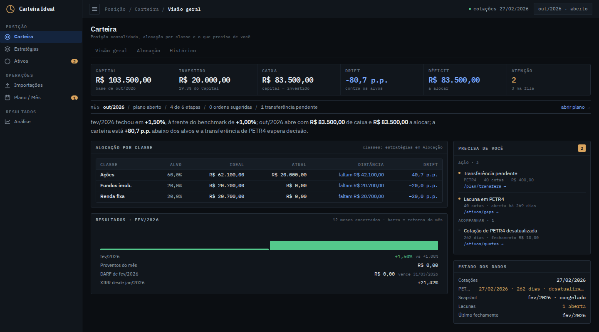

# portfolio-2

A personal investment tracker for Brazilian fixed-income and B3 listed assets: it values what you hold today, plans the month against targets, and reports the tax due.



## Quickstart

Requires Docker 25+.

```bash
docker compose up --build
```

Ports: API `8110`, web `8111` (the SPA is at `/portfolio/`), MySQL `8112`.

## Checks

```bash
npm run be:unit          # backend unit lane, no Docker
npm run be:integration   # backend integration lane, needs Docker
npm run be:check         # backend detekt plus the full test suite, needs Docker
npm run fe:typecheck     # SPA typecheck
npm run fe:lint          # SPA lint
npm run fe:test          # SPA tests
npm run fe:build         # SPA production build
npm run check            # canonical all-checks command
```

## How it fits

portfolio-2 registers its recurring consolidation and reporting jobs with [chameidor](https://github.com/luiznaac/chameidor), a sibling scheduler, over the `IScheduleGateway` seam instead of running its own cron loop. The backend serves the HTTP API and the SPA consumes it; `contracts/` holds the wire fixtures both sides test against. Module, seam and entry-point navigation lives in [docs/code-map.md](docs/code-map.md).

## Limits

- The app requires `CHAMEIDOR_TOKEN` at boot; the dev fixture is `dev-portfolio-fixture-token` (see `.env.example`) and the combined image reads it from the gitignored `docker-compose.override.yml` the [acceptance runbook](docs/runbooks/acceptance.md) sets up.
- The screenshot is the product's real dark A · Console UI; the family standard's light-theme preference is not adopted because the product ships no light theme.
- The GitHub social preview is a crop of the screenshot above, uploaded by hand in the repository settings — GitHub exposes no API for it.
- The combined image serves the SPA under `/portfolio/`; a bare `/` returns the shell without its assets.
- Scheduled jobs fire only while chameidor runs on its API role; the Quickstart does not start it.
- The integration lane needs Docker; the unit lane runs without it.
- The backend + SPA dev loop is in the [local development runbook](docs/runbooks/local-development.md).

## Docs

- [AGENTS.md — portfolio-2 monorepo](AGENTS.md) — open it when you need the monorepo conventions, the surface declaration and the run story.
- [AGENTS.md — portfolio-2 backend](backend/AGENTS.md) — open it when you touch the backend's architecture, testing or configuration.
- [Coding standards — Kotlin lane](backend/CODING_STANDARDS.md) — open it when you need the Kotlin idiom rules the tooling does not enforce.
- [AGENTS.md — portfolio-2 frontend](frontend/AGENTS.md) — open it when you touch the SPA's layout, commands or testing.
- [Coding standards — React lane](frontend/CODING_STANDARDS.md) — open it when you need the React idiom rules the tooling does not enforce.
- [Carteira Ideal](CONTEXT.md) — open it when you need the domain vocabulary the code and the UI share.
- [Code map](docs/code-map.md) — open it when you need to go from a seam to the file a change belongs to.
- [Architecture decision records](docs/adr/) — open it when you need the reasoning behind an irreversible choice.
- [Observability — logging & metrics](backend/docs/observability.md) — open it when a change emits or configures telemetry.
- [Migration baseline history](docs/migrations.md) — open it when you touch the V1 baseline or diagnose a schema mismatch.
- [Local development runbook — portfolio-2](docs/runbooks/local-development.md) — open it when you need the backend + SPA dev loop, its env settings and the chameidor hookup.
- [Acceptance runbook — portfolio-2](docs/runbooks/acceptance.md) — open it when you need the full-stack run, the seeds and the Browser scenarios.

## Related projects

- [chameidor](https://github.com/luiznaac/chameidor) — the scheduler portfolio-2 registers its recurring jobs with.
- [environments](https://github.com/luiznaac/environments) — the scaffold this repository was generated from.
